  

  
  
  
  

  <a href="#o-projeto">Projeto</a> ·
  <a href="#estado-atual">Estado atual</a> ·
  <a href="#executar">Execução</a> ·
  <a href="#contrato-da-api">API</a> ·
  <a href="#autenticação">Autenticação</a> ·
  <a href="#testes">Testes</a> ·
  <a href="#equipe">Equipe</a>

## O projeto

O **Cuidar+** organiza a rotina de cuidados da pessoa acompanhada e a colaboração entre familiares e cuidadores. Este repositório contém a API Java da solução, desenvolvida para a **Global Solution 2026/2 da FIAP**, com o tema CitizenTech.

## Estado atual

A entrega inclui os CRUDs de **PessoaAcompanhada**, **AreaCuidado** e **RegistroCuidado**, com persistência JDBC no Oracle. A API usa Docker no Render e integra-se ao dashboard familiar, publicado na Vercel.

- [API no Render](https://cuidar-java.onrender.com/pessoas-acompanhadas)
- [Dashboard familiar na Vercel](https://cuidar-front.vercel.app/dashboard/familiar)

Na validação da entrega, os três CRUDs foram testados pelo Postman na API publicada. A tentativa de gravar um registro com uma área sem vínculo retornou `409 Conflict`. Pelo dashboard, a listagem de pessoas acompanhadas retornou `200 OK` e o cadastro retornou `201 Created`.

## Arquitetura

~~~text
HTTP / JSON
    │
    ▼
Controller ── Mapper / DTOs
    │
    ▼
Service
    │
    ▼
DAO ── JDBC / DataSource ── Oracle
~~~

| Pacote | Responsabilidade |
| :---: | :---: |
| `models` | Entidades do domínio |
| `dto` | Contratos de entrada, saída e erro |
| `mapper` | Conversão entre DTOs e models com ModelMapper |
| `dao` | SQL, `PreparedStatement` e fechamento dos recursos JDBC |
| `service` | Coordenação do CRUD e tratamento de registros inexistentes |
| `controller` | Rotas, validação da entrada e respostas HTTP |
| `exception` / `handler` | Exceções e erros padronizados |
| `config` | Configuração dos beans |

A organização usa o [cineFiap da professora Eliane Marion](https://github.com/ElianeMarion/fiap-ddd-2026/tree/main/cineFiap) como referência. As adaptações para a GS incluem injeção pelo construtor, `DataSource` no DAO, ModelMapper e tratamento global de exceções. O acesso ao banco usa JDBC diretamente.

## Executar

### Preparar o Oracle

1. No Oracle SQL Developer, conecte-se a um schema vazio com permissão para criar tabelas e sequences.
2. Use **Arquivo → Abrir** para abrir [`docs/sql/cuidar-schema.sql`](./docs/sql/cuidar-schema.sql) e selecione a conexão do schema na planilha SQL.
3. Pressione **F5 (Executar Script)** para executar o arquivo inteiro. Confira a saída do script para identificar eventuais erros de criação.

Em seguida, execute o [script de autenticação](./docs/sql/cuidar-autenticacao.sql) na mesma conexão. A execução desses scripts em um schema vazio ainda precisa ser validada. Para testar registros de cuidado, cadastre a pessoa acompanhada, a área e o usuário criador. Se informar usuário executor, medicamento ou consulta, cadastre também essas referências. Habilite a área para a pessoa inserindo o par em `TB_PESSOA_AREA_CUIDADO` e confirme os dados com `COMMIT` antes de chamar a API.

### Rodar a API no Windows

Use o JDK 21 e tenha acesso à internet no primeiro uso do Maven Wrapper. Configure as variáveis na sessão do PowerShell antes de iniciar a API.

| Variável de ambiente | Valor esperado |
| --- | --- |
| `SPRING_DATASOURCE_URL` | URL JDBC do Oracle no formato `jdbc:oracle:thin:@//HOST:PORTA/SERVICO` |
| `SPRING_DATASOURCE_USERNAME` | Usuário do schema Oracle |
| `SPRING_DATASOURCE_PASSWORD` | Senha do usuário Oracle, definida fora dos arquivos versionados |
| `CUIDAR_CORS_ALLOWED_ORIGINS` | Origens exatas separadas por vírgula, sem curingas ou caminhos. Para o dashboard publicado, use `https://cuidar-front.vercel.app`. O padrão vazio bloqueia requisições de outras origens no navegador. |

Na raiz do projeto, execute pelo PowerShell.

~~~powershell
.\mvnw.cmd spring-boot:run
~~~

A API local fica disponível em `http://localhost:8080`. O `Dockerfile` gera o JAR com o Maven Wrapper em uma etapa com JDK 21 e o executa com JRE 21. No contêiner, a variável `PORT` define a porta HTTP e assume `8080` por padrão.

## Autenticação

O [guia de autenticação e deploy](./docs/autenticacao.md) descreve cadastro, login, sessão, logout e o isolamento dos dados de acompanhamento. Os CRUDs exigem `Authorization: Bearer <token>`.

## Contrato da API

| Recurso | Rota de coleção | Rota de item |
| --- | --- | --- |
| `PessoaAcompanhada` | `/pessoas-acompanhadas` | `/pessoas-acompanhadas/{id}` |
| `AreaCuidado` | `/areas-cuidado` | `/areas-cuidado/{id}` |
| `RegistroCuidado` | `/registros-cuidado` | `/registros-cuidado/{id}` |

| Método | Tipo de rota | Sucesso |
| --- | --- | --- |
| `GET` | Coleção | `200 OK` com a lista |
| `POST` | Coleção | `201 Created` com o recurso criado e o cabeçalho `Location` |
| `GET` | Item | `200 OK` com o recurso |
| `PUT` | Item | `200 OK` com o recurso atualizado |
| `DELETE` | Item | `204 No Content` |

Os IDs das rotas são positivos. As respostas de cadastro, consulta de item e atualização incluem o `id` do recurso. No `PUT`, o ID do recurso atualizado vem da rota.

### Registros por pessoa acompanhada

| Método | Rota | Sucesso |
| --- | --- | --- |
| `GET` | `/pessoas-acompanhadas/{id}/registros` | `200 OK` com os registros da pessoa |
| `POST` | `/pessoas-acompanhadas/{id}/registros` | `201 Created` com o registro e `Location` apontando para `/registros-cuidado/{id}` com o ID do registro criado |

No `POST` aninhado, o ID da pessoa vem da rota. Nos dois caminhos de cadastro e no `PUT /registros-cuidado/{id}`, a pessoa e a área precisam existir e o par precisa constar em `TB_PESSOA_AREA_CUIDADO`. Sem o vínculo, a API retorna `409 Conflict`.

### PessoaAcompanhada

| Campo | Regra para POST e PUT |
| --- | --- |
| `usuarioId` | Positivo, até 10 dígitos, quando houver um vínculo provisionado. Use `null` no cadastro e preserve o valor retornado pela API na atualização |
| `nome` | Obrigatório, com conteúdo além de espaços e até 100 caracteres |
| `dataNascimento` | Obrigatória, no formato `AAAA-MM-DD`, até a data atual e sem idade mínima |
| `observacao` | Opcional, até 300 caracteres |
| `tamanhoFonte` | Obrigatório, de 12 a 32 |
| `altoContraste` | Obrigatório, `S` ou `N` |

~~~json
{
  "usuarioId": null,
  "nome": "Maria Almeida",
  "dataNascimento": "1950-01-02",
  "observacao": null,
  "tamanhoFonte": 18,
  "altoContraste": "S"
}
~~~

### AreaCuidado

| Campo | Regra para POST e PUT |
| --- | --- |
| `nome` | Obrigatório, único, com conteúdo além de espaços e até 50 caracteres |
| `descricao` | Opcional, até 200 caracteres |

### RegistroCuidado

| Campo | Regra para POST e PUT |
| --- | --- |
| `pessoaAcompanhadaId` | Obrigatório em `POST /registros-cuidado` e `PUT /registros-cuidado/{id}`. Positivo e com até 10 dígitos. No POST aninhado, use o ID na rota |
| `areaId` | Obrigatório, positivo e com até 3 dígitos |
| `usuarioCriouId` | Opcional na entrada. A API usa a conta autenticada no cadastro e preserva o criador na atualização |
| `usuarioRealizouId`, `medicamentoId`, `consultaId` | Opcionais. O executor deve ser a conta autenticada ou o executor já registrado. Medicamento e consulta devem pertencer à mesma pessoa acompanhada |
| `titulo` | Obrigatório, com conteúdo além de espaços e até 100 caracteres |
| `detalhe` | Opcional, até 300 caracteres |
| `dataPrevista`, `dataRealizado` | Pelo menos uma é obrigatória. Use data e hora ISO 8601 local, como `2026-11-18T09:00:00` |
| `status` | Obrigatório. Aceita `PENDENTE`, `TOMADA`, `NAO_TOMADA`, `SEM_CONFIRMACAO` ou `CONCLUIDO` |
| `medida`, `medida2` | Opcionais, com até 6 dígitos inteiros e 2 casas decimais |
| `unidade` | Opcional, até 20 caracteres |

### Erros

A API retorna `400` para entrada inválida, `404` para recurso inexistente, `405` para método não permitido e `409` para conflitos, como área sem vínculo, nome de área duplicado ou exclusão bloqueada por referências. Falhas inesperadas retornam `500` com mensagem genérica.

~~~json
{
  "timestamp": "2026-11-13T23:00:00Z",
  "status": 404,
  "erro": "Not Found",
  "mensagem": "Pessoa acompanhada não encontrada.",
  "caminho": "/pessoas-acompanhadas/99",
  "detalhes": []
}
~~~

## Testes

Na raiz do projeto, execute a suíte pelo PowerShell.

~~~powershell
.\mvnw.cmd test
~~~

A suíte cobre os três CRUDs, as rotas aninhadas, a regra de área habilitada, autenticação, isolamento entre famílias, CORS, o carregamento do contexto Spring e o acesso JDBC com mocks. Os testes automatizados rodam sem uma instância Oracle.

**Resultado da execução de 18/11/2026:** 55 testes executados com sucesso, sem falhas, erros ou testes ignorados.

## Equipe

**FIAP · Análise e Desenvolvimento de Sistemas · 1TDSPJ**

| Integrante | RM |
| :---: | :---: |
| Guilherme Almeida | 571713 |
| Leonardo Arnaldo | 573188 |
| Thiago Santa Rosa | 572616 |
| Geovanna Secchi Egea | 573452 |
| Beatriz Urbano M. de Oliveira | 569341 |

Uso de IA no desenvolvimento

O Codex apoiou a configuração do ModelMapper, a implementação dos CRUDs, a criação e execução dos testes automatizados e a revisão deste README. A validação da entrega também incluiu testes manuais com Postman na API publicada e testes de listagem e cadastro pelo dashboard familiar.

---

<strong>Cuidar+</strong> · Todo cuidado em uma só plataforma.

